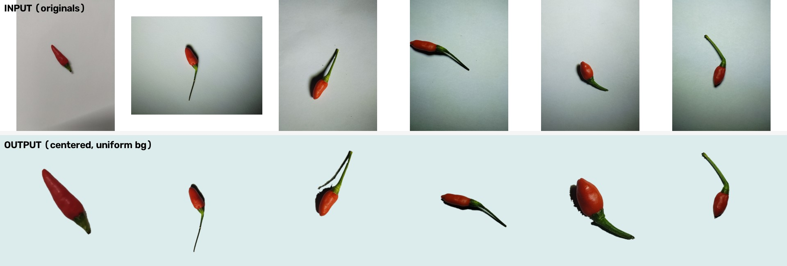

# make-object-to-center

Batch-crop product photos (chili peppers) so the object is **perfectly centered** and placed on a **uniform background**. The tool automatically removes the original background (shadows, vignetting, under-lit corners) and re-composites the object on a flat color.



> Works well for colorful objects on a light/gray background. Robust to soft shadows, gradients and uneven lighting.

---

## Features

- **Robust background removal** using HSV saturation + "darker than background" logic — handles vignetting, gradients, and under-lit areas.
- **Centers on the fruit body** (center of mass), not the stem.
- **Stem always stays inside the frame** — the crop expands toward the stem automatically.
- **Uniform background** (configurable color; default white).
- **Square output**, default `1024×1024`.
- **Fast batch processing** (~0.4 s per 4K image, ~200 images/minute).
- Safe fallback if segmentation fails, and it verifies that every file is actually written.
- Preserves original filenames.

---

## Requirements

- Python 3.9+
- OpenCV + NumPy

```bash
python3 -m pip install -r requirements.txt
```

`requirements.txt`:

```
opencv-python-headless>=4.8
numpy>=1.24
```

> On some systems you may need `--user --break-system-packages`:
> `python3 -m pip install --user --break-system-packages -r requirements.txt`

---

## Quick start

```bash
# Crop a folder of images
python3 crop_chili.py --input ./examples/red-chili/input --output ./out

# Preview first 12 images as side-by-side comparisons (original | mask | result)
python3 crop_chili.py --input ./examples/red-chili/input --output ./out --visualize 12
```

Results are written to `./out`, keeping the original file names.

---

## Options

| Option | Default | Description |
|---|---|---|
| `--input PATH` | *(required)* | Folder with the original images |
| `--output PATH` | *(required)* | Folder for the cropped results |
| `--size N` | `1024` | Side length of the square output (px) |
| `--fruit-frac F` | `0.5` | Max fraction of the frame the fruit body may occupy (`0.5` = 50%) |
| `--pad P` | `0.12` | Safety margin around the whole object + stem |
| `--bg B,G,R` | `255,255,255` | Output background color in **BGR** order |
| `--visualize N` | `0` | Write comparison images for the first `N` files |
| `--ext .jpg` | `.jpg` | Input file extension to scan |
| `--suffix STR` | `_cropped` | Suffix added to output names (use `--suffix ""` to keep names) |

### Examples

```bash
# Light gray background  (RGB 240,240,240  ->  BGR 240,240,240)
python3 crop_chili.py -i in -o out --bg 240,240,240

# Light cyan background  (RGB 220,235,235  ->  BGR 235,235,220)
python3 crop_chili.py -i in -o out --bg 235,235,220

# Larger object in frame
python3 crop_chili.py -i in -o out --fruit-frac 0.6

# Keep original filenames
python3 crop_chili.py -i in -o out --suffix ""
```

> **Color order:** `--bg` expects **B,G,R** (OpenCV order). For RGB `(220, 235, 235)` pass `--bg 235,235,220`.

---

## How it works

1. **Detect the fruit body** — the largest high-saturation region (HSV `S`), which is stable even when the object is under-lit. A small morphological opening removes the thin stem from the body mask.
2. **Compute the center** — the center of mass of the fruit body becomes the center of the output frame.
3. **Detect the stem** — pixels that are both *colored* and *darker than the background*, connected to the fruit (shadows and background cast are excluded).
4. **Size the frame** —
   `side = max( fruit_dim / fruit_frac , 2 · R · (1 + pad) )`
   where `R` is the farthest distance from the fruit center to any object pixel. This guarantees the stem stays inside.
5. **Composite** — the object is pasted onto a flat background color with a feathered alpha edge.

Because the stem must always fit, an object with a very long stem will occupy **less than** `fruit-frac` of the frame (the value is a maximum, not a fixed size).

---

## Example dataset

`examples/red-chili/` contains 12 representative red-chili photos:

```
examples/red-chili/
├── input/     # 12 original 4K photos
├── output/    # 12 cropped 1024×1024 results
└── preview.jpg
```

The sample outputs use a light cyan background `RGB(220,235,235)`.

---

## Tips & troubleshooting

- **Object touches the edge / too tight** → increase `--pad` (e.g. `0.15`) or decrease `--fruit-frac`.
- **Object too small** → increase `--fruit-frac` (e.g. `0.6`); note the stem may get closer to the edge.
- **Halo / gray patches included** → the object likely has a colored background cast; try a different background or tune thresholds in `segment_pepper()`.
- **Only one object per image** — the tool keeps the largest object. Images with multiple objects are not supported out of the box.
- **Exact background color** — JPEG is lossy, so the background may differ by ±1. Use PNG output or JPEG quality 100 if you need exact pixels.

---

## Repo structure

```
make-object-to-center/
├── crop_chili.py
├── requirements.txt
├── README.md
├── LICENSE
└── examples/
    └── red-chili/
        ├── input/
        ├── output/
        └── preview.jpg
```

---

## English quick start

```bash
pip install -r requirements.txt
python3 crop_chili.py --input ./examples/red-chili/input --output ./out
```

Centers the object on its body (not the stem), keeps the stem inside the frame, and pastes it on a uniform background (`--bg B,G,R`, default white). Output is `1024×1024` by default.

---

## License

MIT — see [LICENSE](LICENSE).
